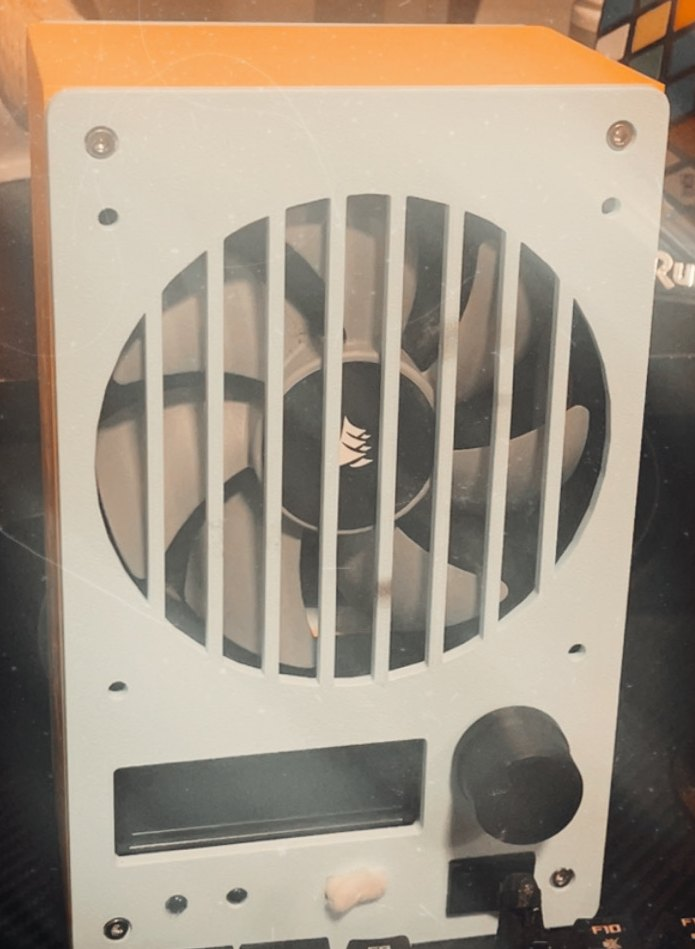
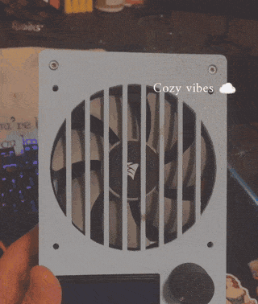
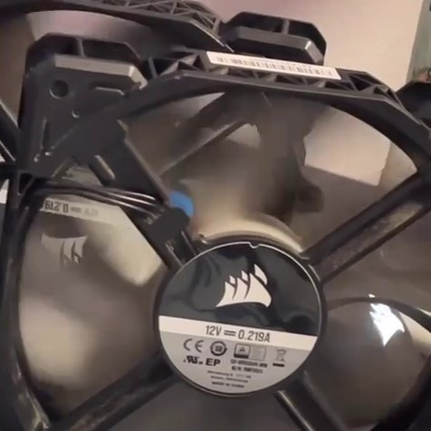
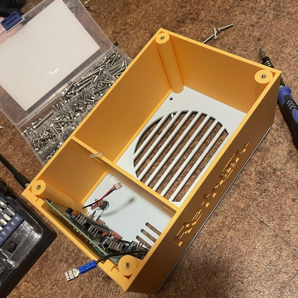
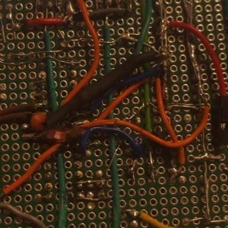
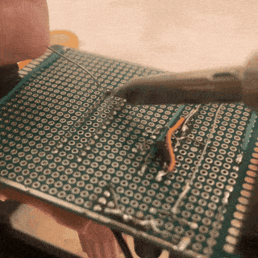
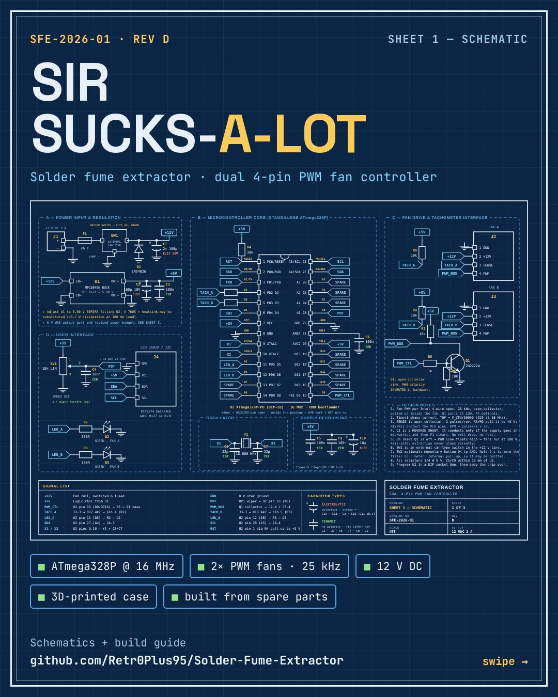
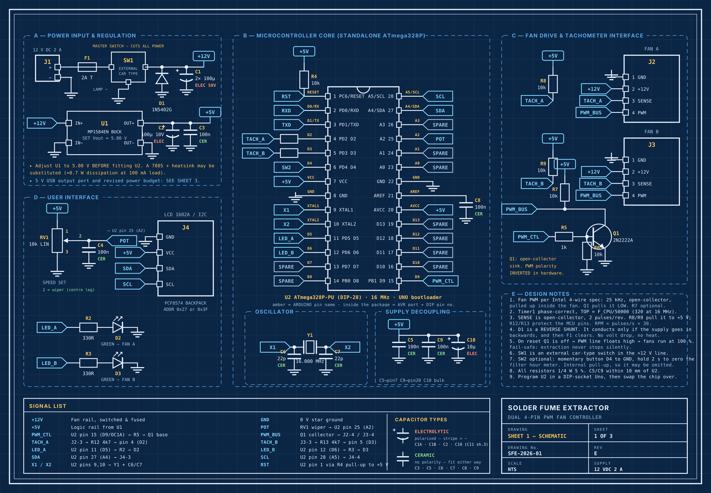
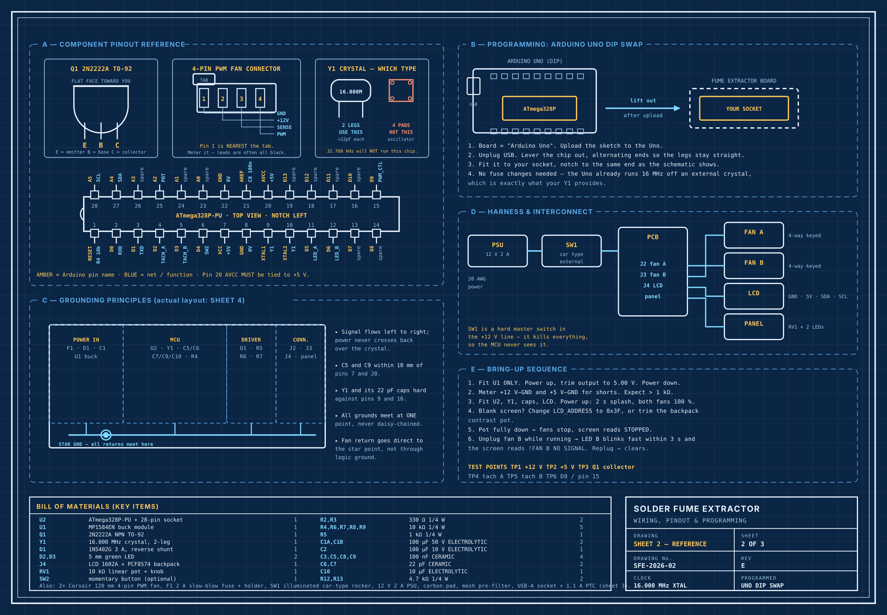
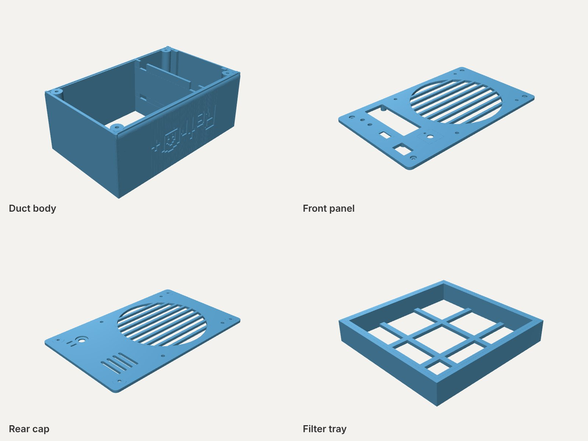

# Sir Sucks-a-Lot

A solder fume extractor for the electronics bench: two 120 mm PWM fans pull the fumes
through a mesh pre-filter and an activated-carbon pad. A bare ATmega328P sets the fan
speed from a knob, reads both fans' real RPM back, and shows it all on a 1602 LCD. The
case is designed from scratch and 3D printed; most of the electronics are spare parts.

<p>
  
  
</p>

## Project status

**Finished and working** (November 2026). The knob sets both fans and the LCD reads them
back: at 64 % they ran at 1800 and 1830 rpm. Drawing set SFE-2026 **Rev E**, firmware
**v1.3**. How it got there, including the seven faults found on the way, is in the
[build log](docs/Build_Log.md).

## Features

- Two 120 mm 4-pin PWM fans, 25 kHz PWM, each fan's tachometer read separately
- ATmega328P at 16 MHz, programmed in an Arduino Uno and moved to the board
- 1602 I²C LCD: speed, state, both RPMs, filter hours
- 10 kΩ linear speed knob with a small dead band so it can't flicker on and off
- Fan stall detection with automatic restart attempts
- Fail-safe: a crashed or unpowered controller leaves the fans at full speed, and a
  watchdog resets the chip if the firmware hangs
- Activated-carbon filter with a mesh pre-filter, in a printed tray
- Optional 5 V / 1 A USB output (designed on sheet 3, not fitted on the prototype)

## Pictures

<table>
  <tr>
    <td width="50%"><br><b>Running:</b> 64 % speed, 1800 and 1830 rpm</td>
    <td width="50%"><br><b>The fans:</b> two Corsair 120 mm, in line inside the duct</td>
  </tr>
  <tr>
    <td><br><b>Inside:</b> the board in its bay, the fan duct beside it</td>
    <td><br><b>Underside:</b> every link hand-wired on a 7 × 9 cm perfboard</td>
  </tr>
  <tr>
    <td><br><b>Building it:</b> soldering the bus wires, 6× speed</td>
    <td><br><b>The poster</b> (sheet 1 as it was at Rev D)</td>
  </tr>
</table>

## As built vs the drawings

The drawings show the recommended circuit. The prototype differs in a few places. The
full list, with why, is in the [build log](docs/Build_Log.md#as-built-vs-the-drawings).

| Item | Drawings | Prototype |
|---|---|---|
| Speed knob input | A2, chip pin 25 | Same (the chip's A0 was damaged during debugging) |
| 5 V regulator | MP1584 buck module | L7805CV (allowed on sheet 1; fine for the logic, not for the USB port) |
| Tach protection | 4.7 kΩ (R12, R13) in series to pins 4 and 5 | Not fitted yet; recommended |
| C4 pot filter | 100 nF from the knob's line to ground | Not fitted |
| Board | 32 × 20 hole layout on sheet 4 | Own placement on a 7 × 9 cm board, chip in header strips |

## Drawings



| | |
|---|---|
|  |  |
| **SFE-02** MCU pinout and programming reference | **SFE-03** USB output and power budget |
|  |  |
| **SFE-04** Reference perfboard layout, 32 × 20 holes | **SFE-D1** Speed potentiometer wiring |

## 3D-printed parts



| File | Part | Size (mm) |
|---|---|---|
| [`retr0-fume-extractor-duct-body.stl`](retr0-fume-extractor-duct-body.stl) | Duct body, with the Retr0+ logo on the side | 127 × 207 × 80 |
| [`retr0-fume-extractor-front-panel.stl`](retr0-fume-extractor-front-panel.stl) | Front panel: fan grille and the openings for the display and controls | 127 × 207 × 10 |
| [`retr0-fume-extractor-rear-cap.stl`](retr0-fume-extractor-rear-cap.stl) | Rear cap: fan grille, a panel hole and vents | 127 × 207 × 3 |
| [`retr0-fume-extractor-filter-tray.stl`](retr0-fume-extractor-filter-tray.stl) | Filter tray for the carbon pad and mesh pre-filter | 116 × 120 × 20 |

## Repository layout

```text
firmware/
  SolderFumeExtractor/    Arduino sketch, v1.3 (open this folder in the Arduino IDE)
  tests/                  Host-side logic tests
  tools/                  Real avr-gcc build script
hardware/
  layout/                 Perfboard layout data, checker and renderer
docs/
  Build_Guide.md          Full build and wiring guide
  Build_Log.md            The prototype: faults found, as-built differences, lessons
  schematics/             Schematic, reference and USB drawings (SFE-01 to SFE-03), SVG + PNG
  layout/                 Perfboard and potentiometer drawings (SFE-04, SFE-D1), SVG + PNG
images/                   Copies of the drawings for this README, and the printed-parts picture
  photos/                 Photos and clips of the finished build
*.stl                     The four 3D-printed enclosure parts
forge-project.json        Maker Forge Bench project file
check.sh                  Runs every check (Git Bash on Windows)
CLAUDE.md                 Notes for working on this with Claude Code
LICENSE                   MIT
```

## Documentation

[`docs/Build_Guide.md`](docs/Build_Guide.md) has the complete wiring, bill of materials,
programming, bring-up procedure, troubleshooting, USB output and perfboard layout.
[`docs/Build_Log.md`](docs/Build_Log.md) is the story of the first build and what it taught.

## Firmware

The firmware (v1.3) is in
[`firmware/SolderFumeExtractor/SolderFumeExtractor.ino`](firmware/SolderFumeExtractor/SolderFumeExtractor.ino).
It lives in a folder of the same name because the Arduino IDE requires that. Choose
**Arduino Uno** as the board.

Library: **LiquidCrystal I2C** by Frank de Brabander (Arduino Library Manager).

The chip runs from a 16 MHz external crystal with the Arduino Uno bootloader and fuse
settings, as described in the build guide.

## Checks

`./check.sh` runs everything: the perfboard layout's electrical and physical check, a
self-test proving that check catches deliberate faults, a redraw of sheet 4 from the
checked data, the Maker Forge export and its test, the firmware logic tests, and a real
AVR build if `arduino-cli` or `avr-gcc` is installed.

## Safety

This project is intended to reduce exposure to soldering fumes; it is not a substitute for
general workshop ventilation or appropriate safety practices. Activated carbon reduces
exposure but does not eliminate all contaminants. Keep the extractor close to the
soldering joint and maintain room ventilation.

The project uses a 12 V supply and contains fused power wiring. Follow the build guide's
power-up and continuity checks before installing the microcontroller.

## License

MIT
