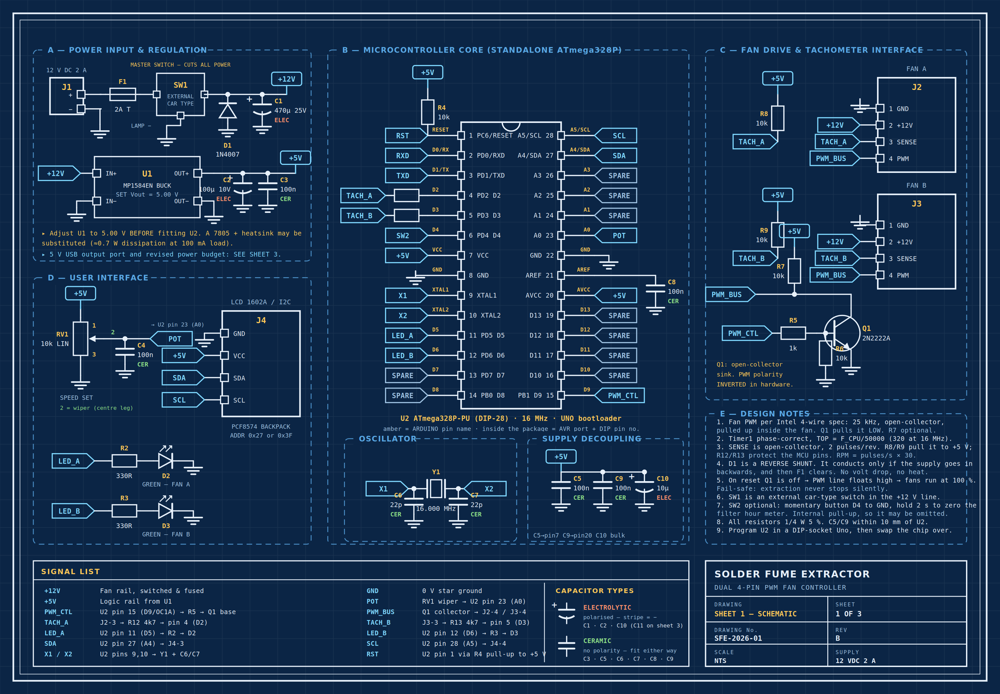
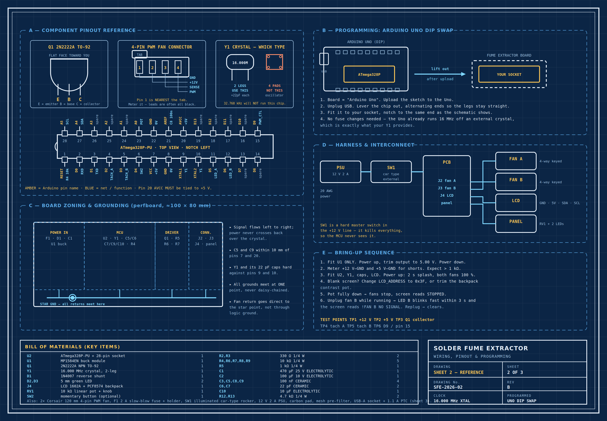
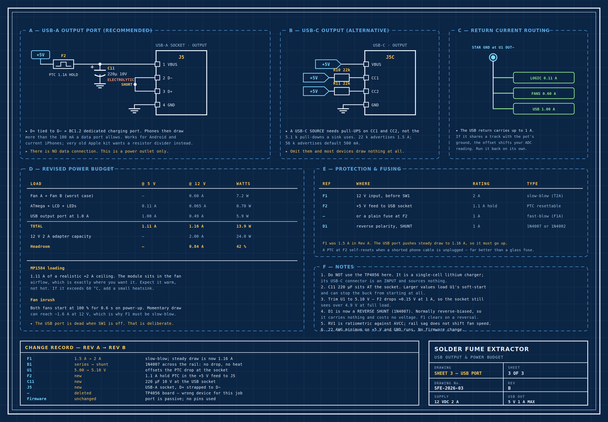
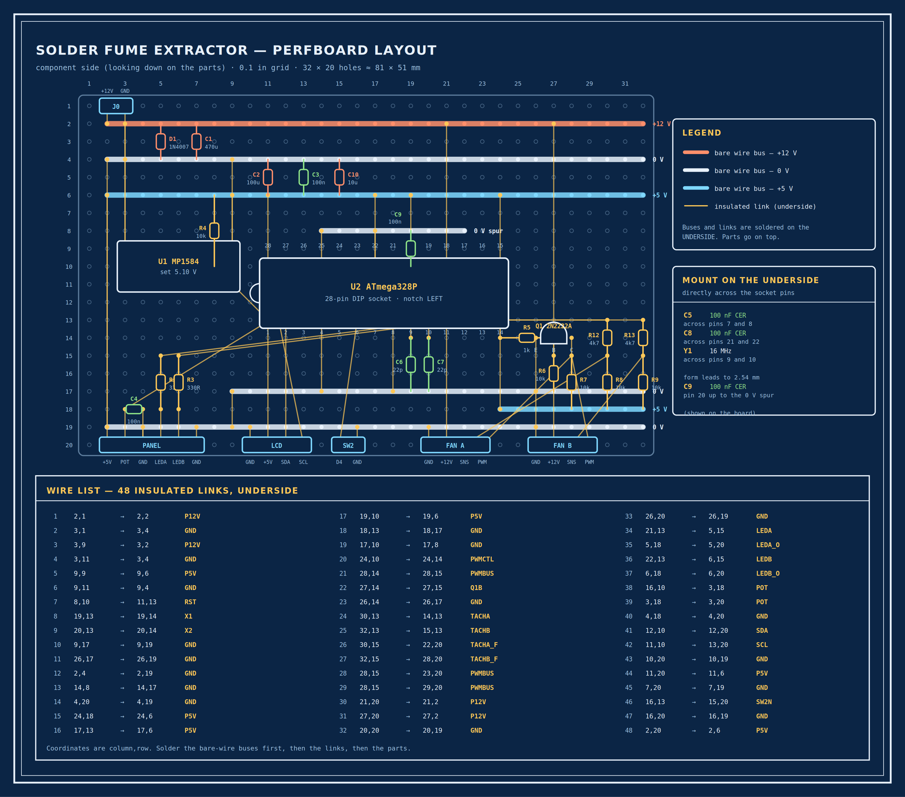
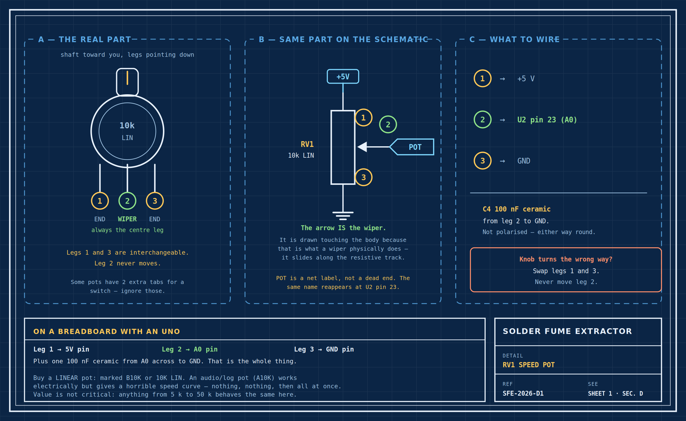
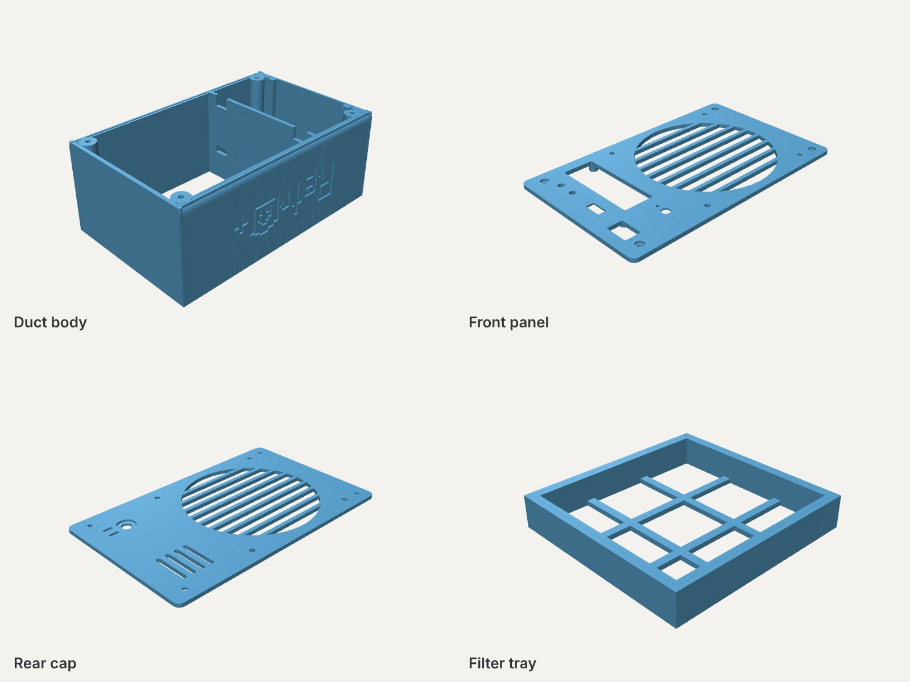

# Solder Fume Extractor

A custom solder fume extractor built to provide adjustable fume capture for an electronics workbench. The system combines dual 120 mm PWM fans, real-time RPM monitoring, microcontroller-based speed control, an LCD interface, and replaceable activated-carbon filtration in a custom enclosure.



## Features

- Dual 120 mm 4-pin PWM fans
- ATmega328P controller at 16 MHz
- 25 kHz PWM fan control
- Individual fan tachometer monitoring
- 1602 I²C LCD status display
- 10 kΩ linear speed control
- Fan stall detection and automatic restart
- Watchdog fail-safe
- Activated-carbon filtration with mesh pre-filter
- Optional 5 V / 1 A USB output
- Custom enclosure / 3D-printed parts

## Project status

Hardware bring-up and testing, drawing set SFE-2026 Rev C and firmware v1.2. The electronics are being verified before the final perfboard and enclosure assembly. The enclosure parts are ready to print.

## Pictures

| | |
|---|---|
|  |  |
| **SFE-02** MCU pinout and programming reference | **SFE-03** USB output and power budget |
|  |  |
| **SFE-04** Perfboard layout, 32 × 20 holes | **SFE-D1** Speed potentiometer wiring |

## 3D-printed parts



| File | Part | Size (mm) |
|---|---|---|
| [`retr0-fume-extractor-duct-body.stl`](retr0-fume-extractor-duct-body.stl) | Duct body, with the Retr0+ logo on the side | 127 × 207 × 80 |
| [`retr0-fume-extractor-front-panel.stl`](retr0-fume-extractor-front-panel.stl) | Front panel: fan grille and the openings for the display and controls | 127 × 207 × 10 |
| [`retr0-fume-extractor-rear-cap.stl`](retr0-fume-extractor-rear-cap.stl) | Rear cap: fan grille, a panel hole and vents | 127 × 207 × 3 |
| [`retr0-fume-extractor-filter-tray.stl`](retr0-fume-extractor-filter-tray.stl) | Filter tray for the carbon pad and mesh pre-filter | 116 × 120 × 20 |

## Repository layout

```text
firmware/                 Arduino firmware (SolderFumeExtractor.ino, v1.2)
docs/
  Build_Guide.md          Full build and wiring guide
  schematics/             Schematic, reference and USB drawings (SFE-01 to SFE-03)
  layout/                 Perfboard and potentiometer drawings (SFE-04, SFE-D1), with the layout as SVG
images/                   The drawings at README size, and the picture of the printed parts
*.stl                     The four 3D-printed enclosure parts
```

## Documentation

See [`docs/Build_Guide.md`](docs/Build_Guide.md) for the complete wiring, bill of materials, programming, bring-up procedure, troubleshooting notes, USB output and perfboard layout information.

## Firmware

The current firmware is in [`firmware/SolderFumeExtractor.ino`](firmware/SolderFumeExtractor.ino).

The firmware uses an ATmega328P with a 16 MHz external crystal and the Arduino Uno bootloader/fuse configuration described in the build guide.

## Hardware

The design documentation includes:

- Main system schematic
- MCU pinout and programming reference
- USB output and power budget
- Verified 32 × 20 hole perfboard layout
- Speed potentiometer wiring detail

## Safety

This project is intended to reduce exposure to soldering fumes; it is not a substitute for general workshop ventilation or appropriate safety practices. Activated carbon reduces exposure but does not eliminate all contaminants. Keep the extractor close to the soldering joint and maintain room ventilation.

The project uses a 12 V supply and contains fused power wiring. Follow the build guide's power-up and continuity checks before installing the microcontroller.

## License

MIT
