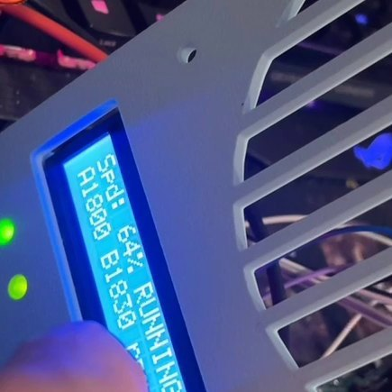

# Build log — the prototype

The first unit, Sir Sucks-a-Lot, was finished on 14 November 2026 and works: the knob sets both fans'
speed and the LCD reads them back (64 % gave 1800 and 1830 rpm). Getting there took two
days of debugging and seven faults. Six were wiring, soldering or assembly mistakes, not
bad parts; the seventh was a damaged input pin on the chip.

**The prototype:** standalone ATmega328P-PU at 16 MHz with the Uno bootloader, firmware
v1.3, a 7 × 9 cm perfboard with the chip in female header strips, a 3D-printed case, and
mostly spare parts. Power runs 12 V 2 A adapter → 2 A slow-blow fuse → car-type switch →
1N5402 reverse-polarity diode and 2 × 100 µF → L7805CV.

## Faults found and fixed

Found in this order by measuring step by step from the adapter towards the chip.

| # | Symptom | Cause | Fix |
|---|---|---|---|
| 1 | 12 V rail live with the switch off (7–9 V, jumpy); regulator output about 6 V | Solder and flux at the joint between the diode/capacitor point and the 12 V rail bridged to the input side, bypassing the fuse and the switch | Removed the joint, ran a new insulated wire from the switch-return pad to the rail, cleaned the flux off with isopropyl alcohol. Rail now 0 V off, about 12 V on |
| 2 | MP1584 buck could not be set to 5.00 V | The trimmer seemed broken. These trimmers are usually multi-turn (10–25 turns), so it may only have needed more turning | Replaced with an L7805CV (fixed 5 V) |
| 3 | 7805 output read 11.8 V, the same as its input | 7805 soldered in backwards | Turned it round: text facing you, the pins are IN, GND, OUT from left to right |
| 4 | LCD showed a row of blocks, fans at 100 %, pot did nothing | The chip had no power: pin 7 (VCC) had only a capacitor and read 1.1 V; ground pins 8 and 22 weren't connected (pin 8 read 4 V) | Wired pin 7 to 5 V and pins 8 and 22 to ground. Before that, proved the chip (Blink), the LCD (an I²C scanner found 0x27) and firmware v1.3 all worked in the Uno |
| 5 | Pot voltage reached the board but not the chip | The wiper went to pin 23 through C4 *in series*, and a capacitor blocks DC | Wired the wiper straight to the pin. C4 belongs from the pin to ground |
| 6 | `!BOTH FANS STOP`, fans at 100 %, pot ignored | The tach lines had their 10 k pull-ups but no wire to chip pins 4 and 5; plus one loose fan connection | Wired each tach line straight to pin 4 or 5. The warning cleared and both fans' RPM showed |
| 7 | Speed stuck at `98% MAXIMUM` | The chip's A0 input is damaged: leg 23 measured 0.6–4.8 V, but the chip read A0 as 1008–1012 out of 1023 whatever the knob did | Moved the pot to A2 (leg 25), which reads 112–1023. Firmware line 94: `PIN_POT = A2`. The drawings now use A2 too |

Fault 6 was the firmware doing its job: the stall check saw no tach pulses from either
fan and said so, and the fail-safe kept both fans at full speed.

## As built vs the drawings

The drawings show the recommended circuit. The prototype differs here:

| Item | Drawings (Rev E) | Prototype |
|---|---|---|
| Pot input | A2, chip pin 25 | Same |
| 5 V regulator | MP1584 buck module, set to 5.00 V | L7805CV linear regulator (sheet 1 lists it as an allowed substitute) |
| Tach lines | 10 k pull-up, then 4.7 k (R12, R13) in series to pins 4 and 5 | 10 k pull-up, wired straight to pins 4 and 5 |
| C4 (pot filter) | 100 nF from the pot line to ground | Not fitted |
| Board | 32 × 20 hole layout, sheet 4 | Own placement on a 7 × 9 cm board, chip in header strips |
| Fans | Two 120 mm 4-pin PWM | Two Corsair 120 mm, in line inside the printed duct |

The 7805 turns the spare 7 V into heat: about 0.7 W at today's ~100 mA, and 3.5 W at
500 mA. That's fine for the logic, but the USB port on sheet 3 needs the buck module back
(or a big heatsink).

## Loose ends

- [ ] Solder the pot wire to leg 25. It's a jumper for now, until new iron tips arrive.
- [ ] Clean the flux between legs 23 and 24 with isopropyl alcohol: pin 24 weakly follows
      the pot (2.5–3.6 V).
- [ ] Recheck the 7805's output. It read 5.4 V once, above its 4.8–5.2 V spec, after being
      in backwards. Replace it if it stays high. C2 (rated 10 V) also saw 11.8 V then.
- [ ] The knob's lowest setting gives about 30 % instead of off, because the pot's bottom
      end sits at 0.55 V. Measure that leg against chip pin 8 with the fans unplugged, then
      running. If the reading moves with the fans, the pot's ground shares a wire with fan
      current: give it its own wire to the chip's ground. If it doesn't move, it's a bad
      joint (about 1.2 kΩ in series, going by the numbers).
- [ ] Fit R12 and R13 (4.7 k) in series with the tach lines. This board has already had
      12 V on its 5 V rail once, which is exactly the fault they protect pins 4 and 5 from.
- [ ] Keep the 7805 off the printed plastic or in the fans' airflow: at 0.7 W a bare TO-220
      runs about 40 °C above room temperature, and PLA starts to soften around 55–60 °C.
- [ ] When convenient, fit a fresh ATmega328P (programmed in the Uno as before). This one
      has a dead A0 and an odd pin 24. Until then it's safe: a dead chip means full-speed fans.
- [ ] Optional: swap the female header strips for a machined-pin 28-pin DIP socket. Flat
      chip legs grip poorly in square headers.

## Lessons for the next build

- **Check power before the chip goes in.** With the chip out, pins 7 and 20 should read
  5 V and pins 8 and 22 should read 0 V.
- **A0 was probably killed by the power faults.** The pot feeds the 5 V rail straight into
  the analogue pin, and that rail sat at 6–12 V for a while. A chip with its ground pins
  open also finds its way to ground through its input pins.
- **Measure in stages from the source:** adapter, fuse, switch, rail, regulator, chip. The
  fault is where the voltage goes wrong.
- **A lone "1" on the meter means open, not 1 Ω.** Use the 20 MΩ range to catch weak leaks
  such as flux.
- **Clean off flux after soldering**, with isopropyl alcohol and a toothbrush. Residue
  leaked several volts on this board.
